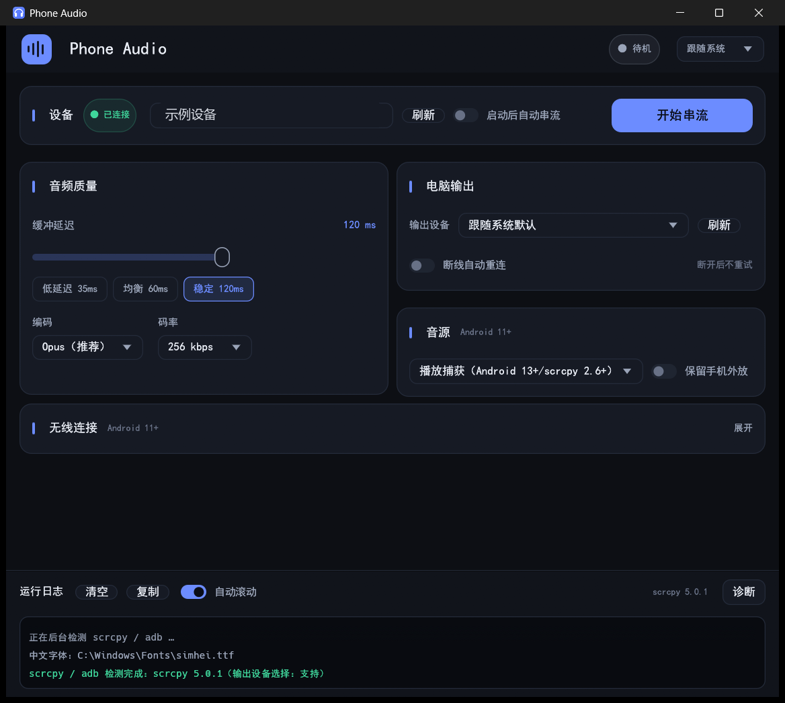

# Phone Audio

[](https://github.com/Wecrane/phone-audio/actions/workflows/build.yml)
[](LICENSE)


把 Android 手机的声音串流到 **Windows 11 / Linux** 电脑，由电脑当前输出设备（例如有线耳机）直接播放。

- **不需要虚拟声卡/驱动**：声音由 scrcpy 直接播放到电脑的音频输出设备
- **手机端不装 App**：通过 adb 临时推送 scrcpy-server，退出即清理
- **纯 Rust 桌面端**：eframe/egui 0.37（glow/OpenGL 渲染后端），单可执行文件
- **可以选择电脑输出设备**（Windows 发行包内置补丁版 scrcpy；Linux 见下文）
- 底层复用 [scrcpy](https://github.com/Genymobile/scrcpy) 的音频转发能力（Android 11+）

> 当前版本 **v0.5.2**。已完成实际编译、单元测试、Windows 本机运行、真机（vivo 测试机 / Android 17，无线调试）串流与打包验证；Linux 运行和 CI 尚未验证，详见 [TESTING.md](TESTING.md)。

## 界面

- 主题：**跟随系统（默认）/ 深色 / 浅色**，右上角切换，偏好写入配置
- 顶部状态胶囊：待机 / 正在启动 / 正在串流 / 正在重连 / 出现错误；设备「已连接」徽标紧挨「设备」标题
- 「设备 + 开始/停止串流」合并为**一行**：设备选择、刷新、启动后自动串流、开始/停止按钮同排垂直居中，按钮靠右；已连接徽标和按钮高度更紧凑
- 下面按音频质量 / 电脑输出 / 音源分区（左右两栏等宽、底边对齐）
- 缓冲滑杆与下面三个延迟预设等宽；主内容区不显示滚动条（仍可用滚轮滚动）
- 「音源」卡把来源下拉和「保留手机外放」放在同一行，卡片更紧凑
- 「诊断」菜单收进运行日志右上角（配置目录 / 声音设置 / 复制诊断信息）
- 运行中自动禁用会破坏当前会话的设置，提示「停止后可修改」
- 可折叠「无线连接」、可调整高度的运行日志（按级别着色、可清空/复制）
- **记住窗口大小**：调整后约 0.8 秒内写盘，下次启动恢复上次尺寸（最小 640×520）；顶部「设置」菜单底部显示当前版本
- **关闭到系统托盘**：点窗口关闭按钮可最小化到托盘继续运行；首次关闭会弹出主题化询问框，之后可在顶部「设置」里修改
- 托盘图标：左键/双击恢复窗口，右键菜单可显示主窗口或退出
- `Ctrl+Enter` 开始/停止；窗口图标、圆角卡片与品牌色
- 窄窗口自动切换单列布局



截图：[浅色主题](docs/screenshots/app-light.png) · [运行中](docs/screenshots/app-running.png) · [关闭到托盘提示](docs/screenshots/close-prompt.png)

## 为什么手机不用装 App

scrcpy 的音频能力来自 **adb shell 权限**，它能把整机音频输出重定向到电脑，并让手机静音。普通 APK 拿不到这个权限；用 MediaProjection/AudioPlaybackCapture 只能抓 `MEDIA/GAME/UNKNOWN`，通知、铃声抓不到，App 还能主动拒绝，手机也会继续外放。

所以这里的选择是：**桌面端做壳，手机端零安装，只开一次 USB 调试**。

## 功能

- 设备列表：USB / 无线，显示 `已连接 / 未授权 / 离线 / 无权限`
- 一键开始/停止纯音频串流（`--no-video --no-control --no-window --require-audio`）
- **选择电脑输出设备**：
  - Windows 发行包内置本项目补丁版 scrcpy（`--audio-output-device` + `--list-audio-devices`），在「音频 → 输出设备」里直接选
  - Linux 版使用 `PULSE_SINK` 指定 PulseAudio/PipeWire sink（实验性）
  - 两者都选「跟随系统默认」时与官方 scrcpy 行为一致
- 音源：整机输出（`output`，手机静音）/ 播放捕获（`playback`，Android 13+，可 `--audio-dup`）
- 编码：Opus（默认）/ AAC / FLAC（scrcpy 2.3+）/ PCM raw（USB 最低延迟）
- 缓冲：UI 滑杆 20–200ms，三档预设 35/60/120ms
- 码率：64/96/128/192/256 kbps（`raw` 时不传 `--audio-bit-rate`）
- 断线自动重连：按 scrcpy 退出码 `2` 触发，1s→2s→…→10s 退避；每次重连重新读取 UI 设置
- **无线端口变化自动恢复**：手机重启/切换无线调试后 `ip:port` 会变；应用在启动与重连时通过 `adb mdns services` 自动发现 `_adb-tls-connect._tcp` 并 `adb connect`，按 IP 匹配旧 serial 后写回配置，不需要重新配对或手动输入地址
- **启动后自动串流**（可选，默认关闭）：只会自动开始/恢复串流；**设备发现与无线自动连接始终开启**，不需要这个开关
- 无线调试配对：`adb pair` + mDNS 自动 `adb connect`（按配对 IP 过滤，避免连错手机）
- **开机自启动**：顶部「设置」菜单开关；Windows 写 HKCU 当前用户 Run 项（无需管理员），Linux 写 `~/.config/autostart/phone-audio.desktop`；也可用 `--enable-autostart` / `--disable-autostart` 命令行切换
- **关闭到托盘（Windows）**：关闭窗口默认询问一次是否最小化到托盘，也可在「设置」里随时切换；托盘右键菜单可退出
- **窗口大小记忆**：最近一次窗口尺寸写入 `settings.json`，启动时恢复
- 日志窗口：捕获 scrcpy stdout/stderr（按字节读、可复制）＋右上角「诊断」菜单
- 配置持久化：`ProjectDirs` 下的 `settings.json`，原子写入、损坏自动备份
- Windows 隐藏控制台窗口（`CREATE_NO_WINDOW`），退出时 `taskkill /T` 清理进程树
- 崩溃/启动失败会写 `crash.log` / `start-error.log`（配置目录）
- scrcpy 能力自动探测：根据 `--version` / `--help` 判断是否支持纯音频、FLAC、播放捕获、输出设备等；版本过旧会禁用开始按钮并给出原因
- 现代化卡片式 UI（`src/theme.rs`）：跟随系统/深/浅主题、状态胶囊、分区卡片、着色日志、快捷键、窗口图标

## 环境要求

### 手机

- Android 11+（音频转发从 Android 11 开始；Android 12+ 体验更好）
- 打开「开发者选项 → USB 调试」
- Android 11 首次开始串流时请保持屏幕解锁

### Windows 11

- Rust stable（MSVC 工具链推荐；GNU 工具链 + MinGW-w64 也可，见 TESTING.md）
- `scrcpy` 与 `adb` 由脚本下载到 `bin/`

### Linux

- Rust stable、`pkg-config`、X11/Wayland/OpenGL 开发库
- `curl`、`unzip`、`tar`（只用于下载依赖，运行时不依赖）
- **不需要系统安装 scrcpy**：脚本会下载官方静态版 scrcpy（x86_64）到 `bin/`

Ubuntu 24.04+：

```bash
sudo apt install build-essential pkg-config curl unzip libusb-1.0-0 \
  libxkbcommon-dev libxkbcommon-x11-dev libx11-dev libxi-dev \
  libxcb1-dev libxcb-render0-dev libxcb-shape0-dev libxcb-xfixes0-dev \
  libgl1-mesa-dev libegl1-mesa-dev libxcursor-dev libxrandr-dev \
  libxinerama-dev libwayland-dev
```

Fedora：

```bash
sudo dnf install gcc gcc-c++ pkg-config curl unzip libxkbcommon-devel \
  libX11-devel libXi-devel mesa-libGL-devel mesa-libEGL-devel \
  libXcursor-devel libXrandr-devel libXinerama-devel wayland-devel
```

> Ubuntu 24.04 自带的 `scrcpy` 是 1.25，**不支持音频**。本项目不用发行版包，而是打包 scrcpy 官方静态 Linux 构建（`scrcpy-linux-x86_64-vX.Y.tar.gz`，>= 2.1）。目前官方静态包只有 x86_64；ARM 机器请自行提供 scrcpy 2.1+ 并通过 `PHONE_AUDIO_BIN` 或 `PATH` 指定。

## 构建与运行

### Windows

```powershell
# 1. 下载 scrcpy + adb 到 bin\（固定 5.0.1、校验 SHA-256）
powershell -ExecutionPolicy Bypass -File scripts\fetch-windows-deps.ps1

# 2. 运行（开发）
cargo run --release

# 3. 打包 zip
powershell -ExecutionPolicy Bypass -File scripts\package-windows.ps1
```

产物：`dist\phone-audio-windows-x64.zip`，解压后 `phone-audio.exe` 与 `bin\` 同级。

### Linux

```bash
# 1. 下载官方静态 scrcpy + adb 到 bin/
bash scripts/fetch-linux-deps.sh

# 2. 运行（开发）
cargo run --release

# 3. 打包 tar.gz（内含 bin/，目标机器无需安装 scrcpy）
bash scripts/package-linux.sh

# 产物：dist/phone-audio-linux-x86_64.tar.gz
```

### 开发时指定二进制目录

```bash
PHONE_AUDIO_BIN=/path/to/scrcpy-and-adb cargo run --release
```

查找顺序：`PHONE_AUDIO_BIN` → 可执行文件旁 `bin/` → 可执行文件同目录 → 项目根 `bin/`（开发）→ `PATH`。

## 选择电脑输出设备

scrcpy 上游（截至 5.0.1）**没有**指定输出设备的选项，只能跟随系统默认输出。本项目通过一个很小的 scrcpy 补丁解决：

- 补丁：`vendor/scrcpy-patched/scrcpy-5.0.1-phone-audio.patch`（8 个文件，+123/−5，只改客户端，不动 server/socket 协议）
- 新增 `--audio-output-device=<name>` 与 `--list-audio-devices`
- 补丁版 `scrcpy.exe` 在 `vendor/scrcpy-patched/win64/scrcpy.exe`，`fetch-windows-deps.ps1` 会自动叠加并校验 SHA-256
- 构建步骤、原始测试输出、已知限制：见 [docs/scrcpy-output-device.md](docs/scrcpy-output-device.md)

选择方式：应用「音频 → 输出设备 → 下拉框」。设备名来自 SDL（例如 `耳机 (Lian II)`、`扬声器 (Realtek(R) Audio)`），**精确匹配、大小写敏感**；设备不存在时 scrcpy 会报错（不会静默回退默认）。

Linux 版目前不打包补丁版 scrcpy：如果检测到当前 scrcpy 不支持 `--audio-output-device`，应用会在有 `pactl` 时枚举 PulseAudio/PipeWire sink，并通过 `PULSE_SINK`（以及强制 `SDL_AUDIODRIVER=pulseaudio`）让 scrcpy 输出到指定 sink。该路径**未在 Linux 真机验证**，UI 标记为实验性。

## 使用

1. 手机开 USB 调试，插线，手机弹窗点「允许」。
2. 应用里点「刷新」，选中设备。
3. 选缓冲档位（USB 建议 35–60ms；Wi-Fi 建议 60–120ms）。
4. 选输出设备（默认「跟随系统默认」；建议选有线耳机）。
5. 点「开始串流」。
6. 声音从所选输出设备播放；手机自身静音。

无线（Android 11+）：

1. 手机「开发者选项 → 无线调试 → 使用配对码配对」。
2. 把 `IP:配对端口` 和 6 位配对码填进应用，点「配对」。
3. 应用会按配对地址的 IP 过滤 mDNS 并自动 `adb connect`；失败时把无线调试页面的 `IP:端口` 填入「连接地址」，点「连接」。

## 延迟与音质

| 场景 | 建议 |
|---|---|
| USB，追求低延迟 | 缓冲 35ms，编码 `raw`（PCM，约 1.5Mbps，USB 无压力） |
| USB，日常 | 缓冲 50–60ms，Opus 128kbps |
| Wi-Fi 5GHz | 缓冲 60–120ms，Opus 96–128kbps |
| Wi-Fi 2.4GHz / 抖动大 | 缓冲 120ms 以上 |

`raw` 只建议 USB 使用；Wi-Fi 下码率太高容易拥塞。

> “播放捕获 / `--audio-dup`”需要 **Android 13+ 且 scrcpy >= 2.6**；老版本 scrcpy 会在 UI 中禁用并在启动前报错。

## 已知限制

- **输出设备**：Windows 使用补丁版 scrcpy 时可选；Linux 的 `PULSE_SINK` 路径为实验性。设备名精确匹配，热插拔/运行中切换需要重新开始串流。
- **DRM / 主动拒绝采集的 App**：Netflix、部分音乐/视频 App 可能没有声音，这是 Android 采集策略决定的。
- **通话/铃声**：部分机型不会进入 `REMOTE_SUBMIX`，可能抓不到。
- **手机端零安装但依赖 adb**：首次需要开发者选项；Windows 可能需要厂商 USB 驱动。
- **Linux 需要 scrcpy >= 2.1**：发行版自带的旧版不行；本项目通过 `fetch-linux-deps.sh` 打包官方静态版。
- 暂无单实例；系统托盘/关闭到托盘已支持（Windows），开机自启动已支持（Windows/Linux 用户级），macOS 未实现。
- 未做代码签名 / 自动更新。

## 排错

**Windows 设备列表为空**

- 换一根能传数据的线，优先插主板后置 USB 口
- 手机通知栏把 USB 模式改成「文件传输」或「USB 调试」
- 装厂商 USB 驱动（小米、三星、华为等），或 Google USB Driver
- 手机上出现 RSA 指纹弹窗时点「允许」

**Linux 显示 `no permissions`**

```bash
sudo apt install android-sdk-platform-tools-common
# 重新插拔手机；仍不行就检查 /etc/udev/rules.d/ 下的 adb 规则
```

**Android 11 没声音**

- 开始串流时保持屏幕解锁（scrcpy 需要一个前台假窗口）
- 系统设置里确认媒体音量不为 0
- 应用会传 `--require-audio`，音频采集失败时状态会变成红色错误，而不是假「正在串流」

**有设备但完全没声音**

- 确认 `bin/scrcpy --version` 是 2.1 以上
- 换一个 App 测试（B 站/YouTube/本地播放器）；Netflix、Apple Music 等 DRM 内容抓不到
- 编码切到 AAC 试试（个别机型没有 Opus 编码器）
- 点运行日志右上角「诊断 → 复制诊断信息」，把版本、设备、日志一起发出来

**爆音、卡顿**

- 缓冲从 35ms 往上调：60 → 100 → 150
- 尽量用 USB；Wi-Fi 用 5GHz，电脑尽量网线
- USB 下可试 `PCM（raw）`，Wi-Fi 下不要用 raw

**无线配对失败**

- 手机和电脑必须同一局域网，路由器不能开 AP 隔离
- Windows 防火墙放行 mDNS（UDP 5353）和 adb
- 配对后用「连接地址」手动 `adb connect`

**选了输出设备但没声音**

- 确认设备名与 `bin\scrcpy.exe --list-audio-devices` 的输出一致（大小写敏感）
- 检查该设备是否被独占（部分声卡驱动/虚拟音频软件会独占）
- 选「跟随系统默认」对比一下，确认是设备选择问题还是音频采集问题

## 目录结构

```
phone-audio/
├─ src/
│  ├─ main.rs        # eframe UI + 引擎线程（启动/守护/重连/日志）
│  ├─ theme.rs       # 深/浅色主题、卡片/胶囊/开关等自定义控件
│  ├─ scrcpy.rs      # scrcpy 能力探测、参数构建、输出设备枚举
│  ├─ adb.rs         # 设备解析、pair/connect/mDNS（全部带超时）
│  ├─ tools.rs       # 二进制查找、无控制台执行、进程树清理
│  └─ settings.rs    # 配置持久化（原子写、损坏备份）
├─ scripts/          # 依赖下载 / 打包脚本（Windows + Linux）
├─ vendor/
│  └─ scrcpy-patched/   # scrcpy 5.0.1 输出设备补丁、补丁版 exe、构建脚本
├─ docs/             # 补丁说明、Linux/CI 文档、界面截图
├─ licenses/         # Apache-2.0、LGPL-2.1 全文
├─ .github/workflows/build.yml
├─ Cargo.toml / Cargo.lock / rust-toolchain.toml
├─ README.md / TESTING.md
├─ LICENSE / NOTICE / THIRD_PARTY_LICENSES.md
```

## 测试状态

- 已在 Windows 11 本机完成：`cargo fmt --check`、`cargo check`、`cargo clippy -D warnings`、`cargo test`（14 个测试）、`cargo build --release`、应用启动/截图、scrcpy+adb 探测、`--list-audio-devices`、退出无残留进程。
- **UI 重做 / 调整（2026-10-24）**：跟随系统/深/浅主题（默认跟随系统）、状态胶囊、着色日志、窄窗口单列自适应；v0.3.6 用「音源」卡替代「工具与诊断」卡、诊断收进日志菜单、滑杆与预设等宽、隐藏滚动条；v0.3.7 把设备选择区压成一行、音源下拉与保留外放同行、去掉多余提示；v0.3.8 收紧右侧两卡间距并让左右两栏底边精确对齐；截图见 `docs/screenshots/`。
- **「启动后自动串流」开关（v0.3.2）**：关闭时启动应用不会自动开始串流（已实测 `scrcpy` 进程未启动）；设备发现/无线自动连接照常工作。
- **开机自启动（v0.4.0）**：已实测顶部「设置 → 开机自启动」与 `--enable-autostart` / `--disable-autostart` 能正确写入/删除 `HKCU\...\Run\PhoneAudio`，含空格的路径引用正确；Linux autostart 代码已实现但未在 Linux 实机验证。
- **关闭到托盘（v0.5.0）**：实测首次关闭弹窗、选择「最小化到托盘」后进程存活且窗口隐藏、再次关闭直接隐藏、选择「退出应用」后进程正常退出；托盘左键恢复/右键菜单退出未自动化点击验证。
- **窗口大小记忆（v0.5.1）**：实测配置 1000×700 启动后窗口物理尺寸 1268×922，关闭写回 1000×700，重启尺寸一致。
- **真机已做基础验证（2026-10-24）**：vivo 测试机（Android 17，无线调试）连接后点击「开始串流」，应用显示「正在串流」，日志出现「音频已开始」，**用户确认能从电脑默认输出现有线耳机听到手机声音**。详见 [TESTING.md](TESTING.md) §3.1。
- **无线端口变化自动恢复（v0.3.1）**：把配置里的 serial 故意改成过期端口 `192.168.1.100:45661` 后启动，应用通过 mDNS 自动连上新端口 `192.168.1.100:42359`、自动开始串流并把新 serial 写回配置；详见 [TESTING.md](TESTING.md) §3.3。
- **尚未验证**：USB 有线串流、串流中断线（非启动时的端口变化）自动重连、应用内无线配对、输出设备切换的端到端听感、Linux 构建/运行、GitHub Actions。

## 路线图

- [x] 编译/测试/打包验证（Windows）
- [x] UI 重做：跟随系统/深/浅主题、合并式设备+串流卡片、状态胶囊、着色日志、窄窗口自适应
- [x] scrcpy 补丁：`--audio-output-device` / `--list-audio-devices`（Windows 构建）
- [x] 版本能力探测、启动预检、崩溃日志、诊断信息
- [x] 真机基础验证：无线调试 + Android 17 + 默认输出出声（2026-10-24）
- [x] 无线端口变化自动发现/连接/写回 serial（v0.3.1）
- [x] 开机自启动（Windows 当前用户注册表 / Linux autostart，v0.4.0）
- [x] 系统托盘 + 关闭到托盘（Windows，v0.5.0）
- [ ] 真机完整矩阵（USB / 拔插重连 / 串流中断线自动重连 / Android 11 锁屏 / 输出设备切换）
- [ ] Linux 版补丁 scrcpy（目前用 PULSE_SINK 兜底）
- [ ] 单实例
- [ ] 安装包（Windows NSIS、Linux .deb/AppImage）
- [ ] 自动更新、多设备同时串流

## 参与贡献

- [CONTRIBUTING.md](CONTRIBUTING.md)：开发环境、检查项、提交规范
- [CHANGELOG.md](CHANGELOG.md)：版本变更记录
- [SECURITY.md](SECURITY.md)：安全问题报告方式
- [Issues](https://github.com/Wecrane/phone-audio/issues) / [Pull requests](https://github.com/Wecrane/phone-audio/pulls)

## 许可证

本项目代码 MIT。运行时调用/分发 scrcpy（Apache-2.0，本项目对 Windows 版有修改，补丁与修改说明随包分发）、adb（Apache-2.0）以及 scrcpy 附带的 FFmpeg/SDL 动态库。

- Windows 发行包中的 FFmpeg（`avcodec-63` 等）、SDL3、libusb DLL 取自官方 scrcpy win64 5.0.1 发行包，按 LGPL-2.1+/zlib 动态链接分发。
- Linux 发行包使用 scrcpy 官方静态构建（FFmpeg/SDL 静态链入），分发前请复核 LGPL 义务（见 `THIRD_PARTY_LICENSES.md`）。

分发二进制时请保留 `LICENSE`、`NOTICE`、`THIRD_PARTY_LICENSES.md`、`licenses/`、`scrcpy-patched/`。详见 `NOTICE`。
